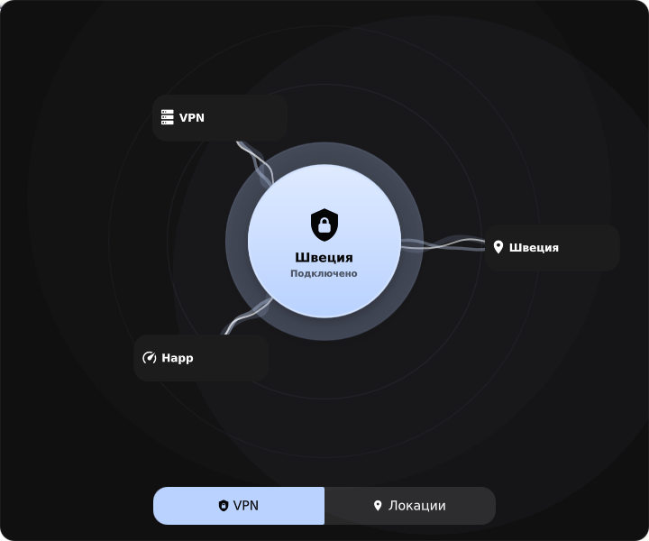

# Serpantinum VPN

**A VPN panel for your Wayland shell.**

[Русский README](README.md) · [Installation details](docs/INSTALL.md) · [Releases](https://github.com/sykia/serpantinum-vpn/releases)

| Connection | Locations |
| --- | --- |
|  |  |

An independent addon for [Serpantinum](https://github.com/ilyamiro/serpantinum),
using [Happ](https://github.com/Happ-proxy/happ-desktop) as its first supported client.
It adds a VPN bar module, an animated connection panel, location search and TCP latency checks.
The central button sends Happ connect/disconnect deep links. Server selection happens in Happ.

## Requirements

This experimental release targets **Serpantinum 2.2.5-1**, revision
`a304a330e4a32ab78f491a02fb9b4b06672d1760`, and **Happ 4.4.8 Linux x86_64**.
Python 3, Node.js, Bash and an existing working Quickshell installation are required.
The installer rejects mismatched upstream files before modifying your installation.

NixOS/Hyprland was the original live environment. The portable installer was tested
in isolated homes against both Nix package data and the upstream file structure.
Arch Linux paths and systemd integration are implemented, but a full Arch desktop test
has not been performed. Other VPN clients require a new adapter; they are not supported out of the box.

## Install

Run as your desktop user, **without sudo**:

```bash
git clone https://github.com/sykia/serpantinum-vpn.git
cd serpantinum-vpn
bash install.sh --dry-run
bash install.sh
```

Arch dependencies: `sudo pacman -S --needed python nodejs git`.

On NixOS: `nix shell nixpkgs#python3 nixpkgs#nodejs --command bash install.sh`.

Or extract the release archive and run its `install.sh`. The installer creates a private
shell snapshot, adds the bar module and configures user services for the **next graphical login**.
It never stops/restarts Happ or the shell and never issues connect/disconnect commands during installation.
Happ reconnects to the last selected server at login; fastest-server selection is not implemented.

For unusual paths use `--source`, `--happ`, `--happ-binary`, `--happ-config`, or `--happ-database`.
`--no-happ-autostart` keeps existing Happ startup. `--no-systemd` creates manual launchers only.
The full guide includes Home Manager overrides, manual compositor startup and recovery.

## Updates and removal

The addon snapshot survives normal package updates, but it does not automatically receive upstream changes.
Nix GC roots retain required package paths. Location decoding relies on a **private Happ database format**,
not a public API; newer Happ versions may need a new adapter.

```bash
bash install.sh --uninstall --dry-run
bash install.sh --uninstall
```

Removal restores launch files and removes the added VPN module while keeping unrelated settings edits.
The snapshot/backups are retained so the current session can keep using them.
Happ's login preference changes persist; see the Russian guide for restoring individual keys.

TCP latency uses the current routing and is not ICMP latency, throughput, or tunnel health.
Core process presence does not prove connectivity. A complete disconnect/reconnect cycle,
physical reboot and vertical-bar layout were not tested, to preserve the user's running VPN.

## Credits

Serpantinum and its original components: **Illia Miroshnichenko / ilyamiro**.
Happ: **Happ-proxy**. This project is unofficial and not affiliated with either project.
Happ binaries, subscriptions and credentials are not distributed.
License: **AGPL-3.0-or-later**, preserving upstream attribution. See [LICENSE](LICENSE) and [NOTICE](NOTICE).
